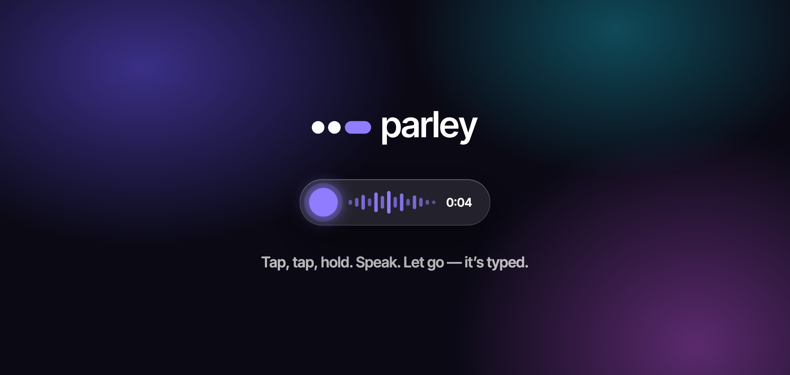
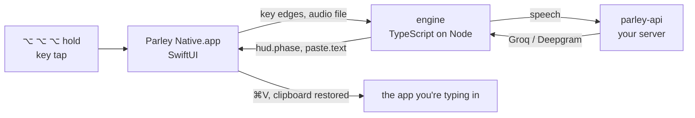

<p align="center">
  <picture>
    <source media="(prefers-color-scheme: dark)" srcset="docs/assets/parley-lockup-dark.svg">
    
  </picture>
</p>

<p align="center">
  <strong>Voice dictation for macOS that stays out of your way.</strong><br>
  Tap, tap, hold. Speak. Let go — it’s typed wherever your cursor is.
</p>

<p align="center">
  <a href="#requirements"></a>
  <a href="macos/"></a>
  <a href="engine/"></a>
  <a href="LICENSE"></a>
  <a href="CONTRIBUTING.md"></a>
</p>

<p align="center">
  
</p>

---

## Why Parley

Most dictation tools want a window, a hotkey chord or a click. Parley wants one
gesture on a key you never use for anything else: **tap your dictation key
twice, hold the third press, talk, release.** A small glass pill shows that
it is listening; when you let go, the text lands at your cursor — in any app,
any text field, any terminal.

- **Native and quiet.** A SwiftUI menu-bar app, no dock icon, no windows in your
  way. The microphone is open only while you hold the key.
- **Your words, spelled your way.** A personal dictionary fixes names and
  jargon (“Mastra”, “Tailscale”, “kubectl”) before the text is pasted.
- **Your keys, your server.** Speech goes to Groq Whisper or Deepgram through
  [`parley-api`](parley-api/), a small server you run. The app never holds a
  provider key.
- **Your clipboard, untouched.** Parley pastes through the clipboard and puts
  back exactly what was there — rich text and images included.

## How it works



The Swift app owns everything that touches macOS — the key tap, the
microphone, Accessibility, the paste and the glass pill. The engine owns the
logic — the gesture, the session, transcription and the dictionary — and runs
headless beside it, speaking newline-delimited JSON-RPC over stdio. The full
map is in [ARCHITECTURE.md](ARCHITECTURE.md).

## Requirements

- macOS 26 or later (Apple silicon or Intel)
- Xcode 26 and [XcodeGen](https://github.com/yonaskolb/XcodeGen) — `brew install xcodegen`
- Node 22 or later, for building the engine
- A [Groq](https://console.groq.com) or [Deepgram](https://deepgram.com) API key for `parley-api`

## Getting started

```bash
git clone https://github.com/shivarajbakale/parley.git
cd parley
./init.sh                      # install dependencies and run the checks

cp parley-api/.env.example parley-api/.env   # add GROQ_API_KEY (or DEEPGRAM_API_KEY)
make api                       # the Parley server on 127.0.0.1:3100

make run                       # build and open Parley Native.app
```

On first launch, click the menu-bar mark and allow **Microphone** and
**Accessibility**. Then, in any text field: tap **Right ⌥** twice, hold the
third tap, speak, release.

> [!TIP]
> macOS ties permissions to the app's code signature. To keep them across
> rebuilds, sign with your own identity: create `macos/Local.xcconfig` with
> `CODE_SIGN_IDENTITY = Apple Development`, your `DEVELOPMENT_TEAM` and
> `CODE_SIGN_STYLE = Automatic`.

## Status

Parley recently moved from Electron to a native SwiftUI app. Every mode is
ported; dictation is verified in daily use and the rest are in live testing.

| | Feature | Gesture (default) | Status |
|---|---|---|---|
| 🎙️ | Dictation with a personal dictionary | Right ⌥ | ✅ verified |
| ✍️ | Voice edit — “make it shorter”, including in terminals | Right ⌘ | 🧪 in testing |
| 💬 | Explain — ask about the selected text | Right ⌃ | 🧪 in testing |
| 🤖 | Act — voice commands run by an agent | Right ⇧ | 🧪 in testing |
| 🪟 | Settings window, dictionary, learning words | — | 🧪 in testing |
| 🔄 | Sync with the Android app | — | 🧪 in testing |

## Repository

| Folder | What | Verify |
|---|---|---|
| [`macos/`](macos/) | the macOS app (SwiftUI) and `ParleyCore`, its tested logic | `make -C macos test` |
| [`engine/`](engine/) | the engine the app runs under a bundled Node | `npm test` |
| [`parley-api/`](parley-api/) | the server: provider keys, sync, the agent's model | `make -C parley-api check` |
| [`parley-agent/`](parley-agent/) | the Mastra agent behind Act | `cd parley-agent && npm test` |
| [`parley-android/`](parley-android/) | the Android app (Flutter) | `make -C parley-android check` |

`make check` runs all of them.

## Privacy

- The microphone is open only while you hold the key; the macOS indicator
  shows it.
- Recordings are temporary files, deleted as soon as they are transcribed.
- Audio goes only to the `parley-api` server you configure, and from there to
  the transcription provider you choose.
- Parley reads nothing from the screen for dictation; it only pastes.

## Contributing

Issues and pull requests are welcome — see [CONTRIBUTING.md](CONTRIBUTING.md).
Design decisions and the reasons behind them live in
[DECISIONS.md](DECISIONS.md).

## License

[Apache-2.0](LICENSE) © Shivaraj Bakale and contributors.
