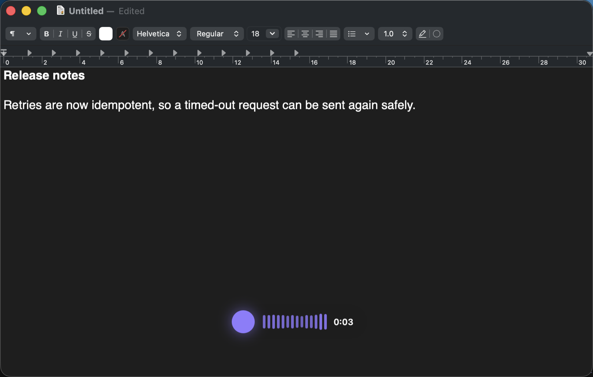
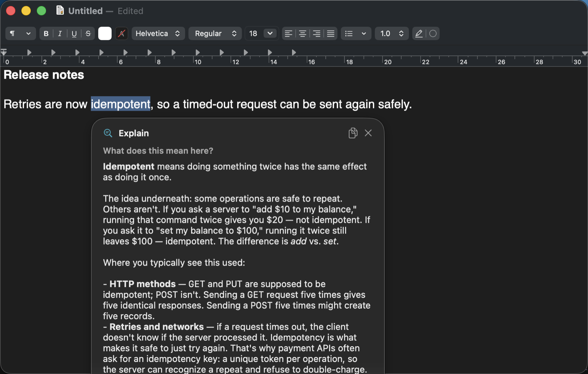
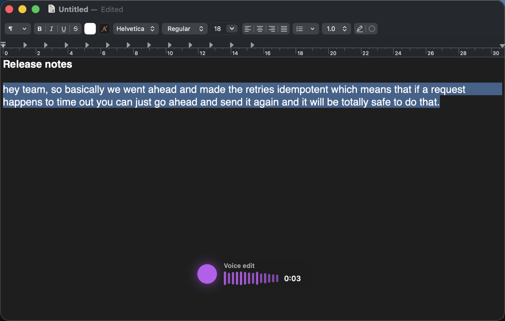
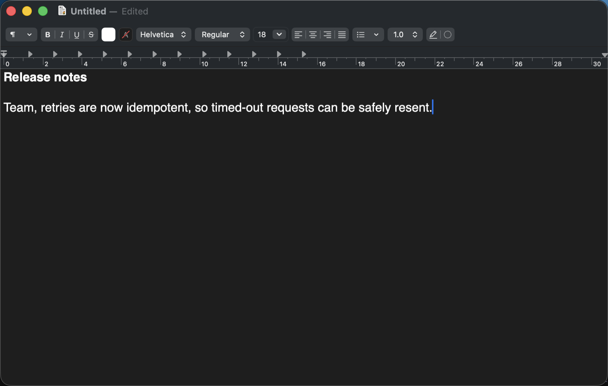
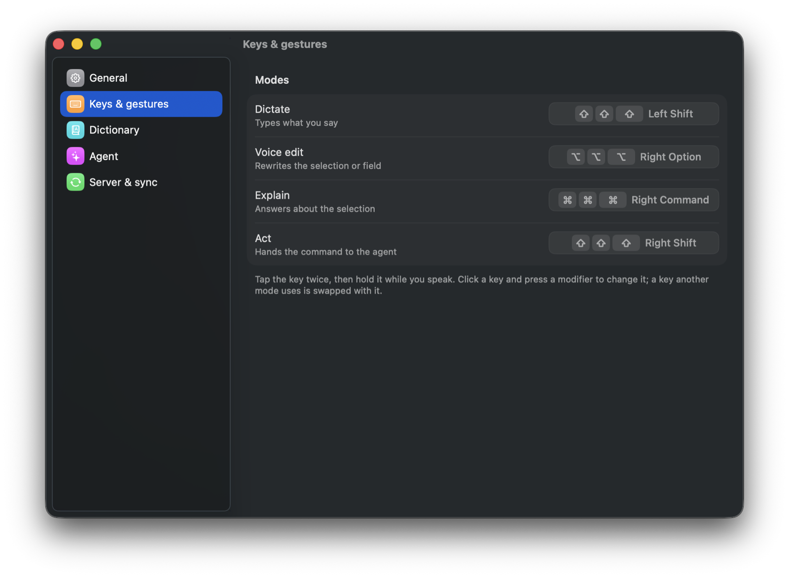
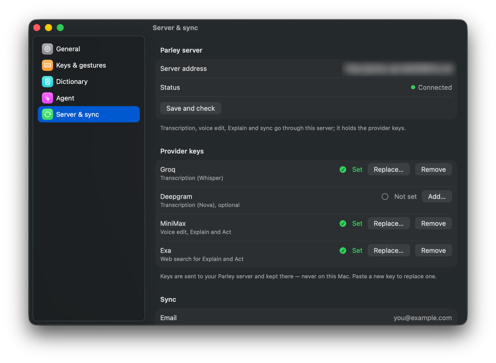
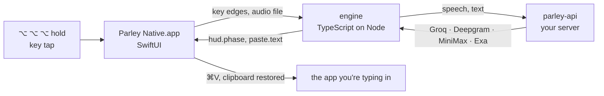

<p align="center">
  <picture>
    <source media="(prefers-color-scheme: dark)" srcset="docs/assets/parley-lockup-dark.svg">
    
  </picture>
</p>

<h3 align="center">Voice for your whole Mac — one gesture away.</h3>

<p align="center">
  Tap, tap, hold. Speak. Let go.<br>
  Parley types, rewrites, explains or acts — in whatever app your cursor is in.
</p>

<p align="center">
  <a href="https://github.com/shivarajbakale/parley/actions/workflows/harness-ci.yml"></a>
  <a href="#requirements"></a>
  <a href="macos/"></a>
  <a href="engine/"></a>
  <a href="LICENSE"></a>
  <a href="CONTRIBUTING.md"></a>
</p>

<p align="center">
  <a href="#quick-start"><b>Quick start</b></a> ·
  <a href="#what-it-does"><b>Features</b></a> ·
  <a href="#how-it-works"><b>How it works</b></a> ·
  <a href="#troubleshooting"><b>Troubleshooting</b></a> ·
  <a href="CONTRIBUTING.md"><b>Contributing</b></a>
</p>

<p align="center">
  
</p>

---

## Why Parley

Most dictation tools want a window, a hotkey chord or a click. Parley wants
one gesture on a key you never use for anything else: **tap it twice, hold
the third press, talk, release.** A small glass pill shows that it is
listening; when you let go, the result lands at your cursor — in any app, any
text field, any terminal.

- **Native and quiet.** A SwiftUI menu-bar app with no dock icon. The
  microphone is open only while you hold the key.
- **Four modes, four keys.** Dictate, rewrite, ask or command — each on its
  own modifier, all with the same gesture.
- **Your words, spelled your way.** A personal dictionary fixes names and
  jargon (“Mastra”, “Tailscale”, “kubectl”) and learns from your corrections.
- **Your keys, your server.** Speech and language models run through
  [`parley-api`](parley-api/), a small server you host. The app never holds a
  provider key.
- **Your clipboard, untouched.** Parley pastes through the clipboard and puts
  back exactly what was there — rich text and images included.

## What it does

Every mode is the same gesture — **tap, tap, hold** — on a different key.
Change any key in **Settings → Keys**: click it and press the modifier you
want. Pick one another mode uses and the two swap.

| Mode | Default key | Hold and say… | What happens |
|---|---|---|---|
| 🎙️ **Dictate** | Right ⌥ ⌥ ⌥ | *“Ship it after the review, thanks”* | The text is typed at your cursor. |
| ✍️ **Voice edit** | Right ⌘ ⌘ ⌘ | *“Make it shorter and friendlier”* | The selection — or the whole field — is rewritten in place. Works in terminals too. |
| 💬 **Explain** | Right ⌃ ⌃ ⌃ | *“What does idempotent mean here?”* | A glass card answers about the selected text, with sources when it searched. |
| 🤖 **Act** | Right ⇧ ⇧ ⇧ | *“Open a PR for this branch”* | An agent runs the command and asks before anything it can’t undo. |

Press **Esc** at any time to cancel.

## Screenshots

<table>
  <tr>
    <td width="50%" valign="top">
      <br>
      <sub><b>Dictate.</b> The pill appears over the window you're typing in while you hold the key.</sub>
    </td>
    <td width="50%" valign="top">
      <br>
      <sub><b>Explain.</b> Select a word, ask out loud, and the answer opens beside it.</sub>
    </td>
  </tr>
  <tr>
    <td valign="top">
      <br>
      <sub><b>Voice edit, before.</b> Select text and say <i>“Make it shorter and more professional.”</i></sub>
    </td>
    <td valign="top">
      <br>
      <sub><b>Voice edit, after.</b> The selection is replaced in place.</sub>
    </td>
  </tr>
  <tr>
    <td valign="top">
      <br>
      <sub><b>Keys.</b> Click a mode and press a modifier to change it.</sub>
    </td>
    <td valign="top">
      <br>
      <sub><b>Provider keys.</b> Sent to your server, never stored on the Mac.</sub>
    </td>
  </tr>
</table>

## Quick start

### Requirements

- macOS 26 or later (Apple silicon or Intel)
- Xcode 26 and [XcodeGen](https://github.com/yonaskolb/XcodeGen) — `brew install xcodegen`
- Node 22 or later
- A [Groq](https://console.groq.com) or [Deepgram](https://deepgram.com) key for speech, and a
  [MiniMax](https://www.minimax.io) key for voice edit, Explain and Act

### Install

```bash
git clone https://github.com/shivarajbakale/parley.git
cd parley
./init.sh                 # install dependencies and run the checks

make api                  # start the Parley server on 127.0.0.1:3100
make run                  # build and open Parley Native.app
```

Then:

1. Click the Parley mark in the menu bar and allow **Microphone** and **Accessibility**.
2. Open **Settings → Server & sync → Provider keys** and paste your keys.
   They are sent once to your server and never kept in the app.
3. In any text field, tap **Right ⌥** twice, hold the third press, speak, release.

> [!TIP]
> macOS ties permissions to the app's code signature. To keep them across
> rebuilds, sign with your own identity: create `macos/Local.xcconfig` with
> `CODE_SIGN_IDENTITY = Apple Development`, your `DEVELOPMENT_TEAM` and
> `CODE_SIGN_STYLE = Automatic`.

### Run the server elsewhere

`parley-api` can live on another machine — a Mac mini at home, say — reachable
only over your [Tailscale](https://tailscale.com) network. See
[`parley-api/deploy`](parley-api/deploy/), then set the server address in
**Settings → Server & sync**. Never expose it to the public internet: anyone
who can reach it can spend your provider keys.

## How it works



The Swift app owns everything that touches macOS — the key tap, the
microphone, Accessibility, the paste and the glass UI. The engine owns the
logic — gestures, sessions, transcription, the dictionary, sync and the agent —
and runs headless beside it under a bundled Node, speaking newline-delimited
JSON-RPC over stdio. The full map, including every message on the wire, is in
[ARCHITECTURE.md](ARCHITECTURE.md).

## Providers

| What | Provider | Server key |
|---|---|---|
| Speech to text | [Groq Whisper](https://console.groq.com) (default) or [Deepgram](https://deepgram.com) | `GROQ_API_KEY` / `DEEPGRAM_API_KEY` |
| Voice edit, Explain, Act | [MiniMax](https://www.minimax.io) (`PARLEY_MODEL`, any Mastra model id) | `MINIMAX_API_KEY` |
| Web search in Explain | [Exa](https://exa.ai) (optional) | `EXA_API_KEY` |

Keys go in **Settings → Provider keys** or in `parley-api/.env`
([example](parley-api/.env.example)). A key saved from the app wins over `.env`.

## Privacy

- The microphone is open only while you hold the key; the macOS indicator shows it.
- Recordings are temporary files, deleted as soon as they are transcribed.
- Audio and text go only to the `parley-api` server you configure, and from
  there to the providers you choose.
- Dictation reads nothing from the screen. Voice edit, Explain and Act read
  the selection or the focused field only when you invoke them.
- Sync is off until you sign in; its token is encrypted with a key in your
  login Keychain.

## Troubleshooting

<details>
<summary><b>System Settings shows Parley Native as allowed, but the app still asks for Accessibility</b></summary>

The grant belongs to an older signature of the app. Remove Parley Native from
**Privacy & Security → Accessibility** with **−**, add it again, and sign your
builds with your own identity (see the tip under [Install](#install)).
</details>

<details>
<summary><b>The menu says a mode is “off”</b></summary>

Two modes share a key, so only the first one listens. Open **Settings → Keys**,
click the mode's key and press a free modifier.
</details>

<details>
<summary><b>Explain says to select text first, but text is selected</b></summary>

Some apps — terminals especially — draw their own selection that macOS can't
read. Copy it with <kbd>⌘</kbd><kbd>C</kbd> (or <kbd>⌥</kbd>-drag in iTerm2)
just before the gesture; Parley uses what you copied in the last 30 seconds.
</details>

<details>
<summary><b>Nothing happens after I let go</b></summary>

Check that the server is reachable in **Settings → Server & sync**, and that a
speech key is set. Then read the logs:

```bash
log show --last 5m --info --predicate 'subsystem == "com.shivarajbakale.parley.mac"'
```
</details>

<details>
<summary><b>The old Electron Parley is installed too</b></summary>

Quit it. The native app won't start its engine while the Electron app runs,
because both would answer the same keys.
</details>

## Repository

| Folder | What | Verify |
|---|---|---|
| [`macos/`](macos/) | the macOS app (SwiftUI) and `ParleyCore`, its tested logic | `make -C macos test` |
| [`engine/`](engine/) | the engine the app runs under a bundled Node | `npm test` |
| [`parley-api/`](parley-api/) | the server: provider keys, models, sync | `make -C parley-api check` |
| [`parley-agent/`](parley-agent/) | the Mastra agent behind Act | `cd parley-agent && npm test` |
| [`parley-android/`](parley-android/) | the Android companion (Flutter) | `make -C parley-android check` |

`make check` runs all of them; CI runs it on every pull request.

## Roadmap

Parley recently moved from Electron to a native SwiftUI app. Dictation is in
daily use; the other modes are ported and in live testing.

- [x] Native menu-bar app, glass pill, dictation with a personal dictionary
- [x] Voice edit, Explain, Act and sync ported to the native app
- [x] Provider keys managed from the app, kept on your server
- [ ] Live checks of voice edit, Explain, Act and sync in the native app
- [ ] Signed and notarized builds on GitHub Releases

## Contributing

Issues and pull requests are welcome — read [CONTRIBUTING.md](CONTRIBUTING.md)
first. Design decisions and the reasons behind them live in
[DECISIONS.md](DECISIONS.md). To report a security issue, see
[SECURITY.md](SECURITY.md).

## Acknowledgements

Built on [Groq](https://groq.com), [Deepgram](https://deepgram.com),
[MiniMax](https://www.minimax.io), [Exa](https://exa.ai),
[Mastra](https://mastra.ai), [XcodeGen](https://github.com/yonaskolb/XcodeGen)
and [Tailscale](https://tailscale.com).

## License

[Apache-2.0](LICENSE) © Shivaraj Bakale and contributors.
